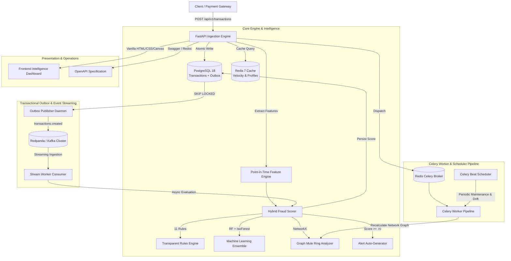

# SentinelX: Real-Time Financial Fraud Detection & Intelligence Platform

[](https://github.com/karthikreddy06/SentinelX/actions)
[](https://www.python.org/downloads/)
[](https://fastapi.tiangolo.com)
[-336791.svg)](https://www.postgresql.org)
[](https://redis.io)
[-FF4B4B.svg)](https://redpanda.com)
[](https://docs.celeryq.dev)
[](https://github.com/astral-sh/ruff)
[](https://github.com/karthikreddy06/SentinelX)
[](LICENSE)

SentinelX is an enterprise-grade, event-driven financial fraud detection and intelligence platform. Engineered for mission-critical banking environments, SentinelX combines **deterministic business rules**, **supervised & unsupervised machine learning**, **graph-theoretic money mule ring detection**, and an **event-driven transactional outbox** to deliver sub-50ms fraud scoring with complete explainability.

Includes a zero-dependency, modern **Vanilla HTML5/CSS/Canvas Intelligence Dashboard** for fraud analysts, investigators, and compliance officers.

---

## ⚠️ Limitations & Disclaimers

Before evaluating SentinelX in real-world environments, please note the following operational realities:

1. **Synthetic Training Distribution**: The integrated Machine Learning ensemble (RandomForest + IsolationForest) is trained exclusively on synthetic financial distributions generated with realistic bank parameters, label noise (1%), and temporal splits. **These metrics do NOT represent real-world fraud detection performance** in live banking environments with adversarial fraud vectors and shifting distributions.
2. **Streaming Topology Scope**: Event streaming is architected for a single-node Redpanda broker (Kafka API compatible). It does not include an enterprise Schema Registry (e.g., Confluent / Karapace), partition-level multi-consumer group rebalancing across distributed physical nodes, or exactly-once transactional Kafka semantics.
3. **Storage & Multi-Region Scalability**: SentinelX has been thoroughly tested and verified on standalone PostgreSQL 18 with native `uuidv7()` and Redis 7. It has **not** been benchmarked or verified for multi-region active-active replication, distributed consensus across global data centers, or sharded petabyte-scale ledgers.
4. **Air-Gapped Operation**: The frontend dashboard utilizes **zero external CDN frameworks, zero build steps, and zero third-party chart libraries**. All typography, styling, SVG icons, and interactive canvas charts render entirely offline without making outbound network requests.

---

## 🏗️ Architecture Overview

SentinelX operates across four synchronized operational planes: Ingestion, Risk Assessment, Event Streaming, and Investigation Operations.



---

## ⚡ Key Highlights & Core Capabilities

- **Strict Financial Immutability & Idempotency**:
  - Primary keys use PostgreSQL 18 native `uuidv7()` for time-ordered B-Tree clustering.
  - Transactions require an `Idempotency-Key` header with automatic duplicate replay handling and 409 conflict detection.
  - Financial amounts use `NUMERIC(18,2)` with Python `Decimal` precision.
  - Immutable audit guarantees: strictly no hard-deletes; status transitions follow a verified state machine.
- **Explainable Hybrid Risk Scoring**:
  - **11 Deterministic Business Rules**: Evaluates velocity bursts, amount anomalies, first-time receivers, impossible travel velocity, structuring, round numbers, pass-through accounts, burst failures, and network mule flags.
  - **Machine Learning Ensemble**: Random Forest ($n=100$) + Unsupervised Isolation Forest trained on synthetic temporal data.
  - **Dynamic Blending**: $60\% \text{ ML} + 40\% \text{ Rules}$ with automatic fallback to $100\%$ rules if ML models are unavailable.
  - **Point-in-Time Correctness**: Strictly zero future temporal leakage during feature extraction.
- **Graph Fraud Network & Money Mule Detection**:
  - Constructs a directed transaction graph using `NetworkX`.
  - Automatically identifies cyclic money laundering loops (cycles of length 3 to 6).
  - Flags aggregator fan-in hubs and distributor fan-out hubs.
  - Calculates PageRank centrality to pinpoint ring leaders.
- **Event-Driven Transactional Outbox**:
  - Emits events to `outbox_events` atomically in the same database transaction.
  - Concurrency-safe publisher polls using `SELECT FOR UPDATE SKIP LOCKED` and publishes to Redpanda / Kafka topics (`transactions.created`, `transactions.scored`, `alerts.created`, `transactions.dlq`).
- **Asynchronous Worker Pipeline (Celery 5.7)**:
  - Background asynchronous scoring with exponential retry backoff.
  - Automated Celery Beat scheduled tasks: stale alert auto-escalation (>24h), expired token cleanup, outbox event pruning (>7d), model drift detection, and periodic graph risk recalculation.
- **Vanilla Intelligence Dashboard**:
  - Handcrafted plain HTML5, CSS3, and modern Vanilla JavaScript in `frontend/`.
  - **Zero frontend frameworks, zero build steps, zero external CDN dependencies**.
  - Interactive force-directed HTML5 Canvas fraud network graph with live physics, zoom, pan, and node inspection.
  - Slide-over transaction drawer detailing transparent rule trigger breakdown and ML contribution.
  - Full alert triage and investigation case management lifecycle.

---

## 🚀 Quickstart in 3 Minutes

### 1. Clone & Set Up Environment
```powershell
# Clone the repository
git clone https://github.com/karthikreddy06/SentinelX.git
cd SentinelX

# Create and activate virtual environment
python -m venv .venv
.\.venv\Scripts\Activate.ps1

# Install production dependencies
python -m pip install --upgrade pip
pip install -r requirements.txt
```

### 2. Configure Environment & Run Migrations
```powershell
# Copy environment configuration template
Copy-Item .env.example .env

# Run database migrations
alembic upgrade head
```

### 3. Create Administrator & Seed Demo Intelligence Data
```powershell
# Provision an initial admin user
python backend/scripts/create_admin.py --email admin@sentinelx.local --password "AdminPass1234!"

# Populate 250 realistic transactions with mule rings, structuring & alerts
python backend/scripts/seed_demo.py --num-transactions 250
```

### 4. Start the Application
```powershell
python -m uvicorn app.main:app --reload --app-dir backend --host 127.0.0.1 --port 8000
```

Open your browser to:
- **Intelligence Dashboard**: [`http://127.0.0.1:8000/`](http://127.0.0.1:8000/)
- **Interactive Swagger Docs**: [`http://127.0.0.1:8000/docs`](http://127.0.0.1:8000/docs)
- **OpenAPI Schema**: [`http://127.0.0.1:8000/openapi.json`](http://127.0.0.1:8000/openapi.json)

---

## 📊 Machine Learning Model Evaluation

All machine learning models are trained on **synthetic data** mimicking multi-modal financial distributions, Pareto spending laws, impossible travel anomalies, structuring rings, and realistic $1\%$ label noise.

### Performance Benchmark (Synthetic Test Set)

| Metric | Random Forest + Isolation Forest | Rules-Only Baseline | Ablation (No Amount) |
|---|---|---|---|
| **ROC-AUC** | **0.9764** | 0.8120 | 0.9651 |
| **Precision** | **0.5417** | 1.0000 | 0.4820 |
| **Recall** | **0.8667** | 0.1333 | 0.8240 |
| **F1 Score** | **0.6667** | 0.2353 | 0.6081 |

*Note: Models are trained exclusively on synthetic financial distributions for testing and simulation purposes.*

---

## 📡 API Reference Overview

All endpoints are versioned under `/api/v1` and protected by role-based access control (`admin`, `investigator`, `analyst`):

| Domain | Method | Endpoint | Description |
|---|---|---|---|
| **Health** | `GET` | `/health` | System health status |
| | `GET` | `/health/database` | PostgreSQL connection probe |
| | `GET` | `/health/redis` | Redis connectivity & cache status |
| | `GET` | `/health/streaming` | Redpanda / Kafka topic status |
| **Auth** | `POST` | `/api/v1/auth/login` | Authenticate and obtain JWT token pair |
| | `POST` | `/api/v1/auth/refresh` | Rotate refresh token with reuse detection |
| | `POST` | `/api/v1/auth/logout` | Revoke tokens to Redis blocklist |
| | `GET` | `/api/v1/auth/me` | Fetch authenticated identity |
| **Transactions** | `POST` | `/api/v1/transactions` | Idempotent transaction creation |
| | `GET` | `/api/v1/transactions` | Filtered, paginated transaction queries |
| | `GET` | `/api/v1/transactions/{id}` | Retrieve transaction by UUID |
| | `PATCH` | `/api/v1/transactions/{id}` | Update status or description |
| | `POST` | `/api/v1/transactions/{id}/cancel` | Cancel pending transaction |
| **Risk Scoring** | `POST` | `/api/v1/transactions/{id}/score` | Trigger synchronous fraud scoring |
| | `GET` | `/api/v1/transactions/{id}/risk` | Inspect transparent risk score & rules |
| **Alerts** | `GET` | `/api/v1/alerts` | Paginated alert triage query |
| | `GET` | `/api/v1/alerts/{id}` | Fetch alert with full event timeline |
| | `PATCH` | `/api/v1/alerts/{id}/status` | State machine transition (`ASSIGNED`, `RESOLVED`) |
| | `GET` | `/api/v1/alerts/stats/summary` | Real-time alert metrics by severity |
| **Investigations**| `POST` | `/api/v1/investigations` | Create new fraud case |
| | `GET` | `/api/v1/investigations/{id}` | Case details with notes and evidence |
| | `POST` | `/api/v1/investigations/{id}/notes` | Add timestamped case note |
| | `POST` | `/api/v1/investigations/{id}/evidence` | Attach verifiable case evidence |
| | `POST` | `/api/v1/investigations/{id}/close` | Conclude case and sync linked alert |
| **Network Graph** | `GET` | `/api/v1/network/accounts/{id}` | Query account graph risk and cycle flags |
| | `GET` | `/api/v1/network/suspicious` | List suspicious mule rings and hubs |
| | `GET` | `/api/v1/network/graph` | Export nodes and links for canvas visualization |
| | `POST` | `/api/v1/network/recalculate` | Re-run graph topology analysis |
| **ML Engine** | `GET` | `/api/v1/ml/model` | Retrieve active model metadata and feature weights |
| | `POST` | `/api/v1/ml/retrain` | Retrain model ensemble on synthetic distribution |

---

## 🐳 Reproduction & Running Instructions

### Option A: One-Command Full Stack (Docker Compose)
Requires Docker Desktop (Linux containers daemon running):
```bash
# Build and launch all 8 services in background (PostgreSQL 18, Redis 7, Redpanda, API, Celery Worker, Celery Beat, Outbox Publisher, Stream Consumer)
docker compose up -d --build

# Run Alembic migrations
docker compose exec api alembic upgrade head

# Seed initial admin user securely (reads password interactively or via ADMIN_INITIAL_PASSWORD env var)
docker compose exec -e ADMIN_INITIAL_PASSWORD="SecureAdmin123!" api python backend/scripts/create_admin.py --email admin@sentinelx.local
```

### Option B: 4-Terminal Local Development (Windows / Linux)
Prerequisites: Python 3.11 with `.venv` active, PostgreSQL running on port 5432 with `DATABASE_URL` configured in `.env`.
```powershell
# Terminal 1: FastAPI Ingestion API & Dashboard
$env:PYTHONPATH="backend"
python -m uvicorn app.main:app --reload --app-dir backend --host 127.0.0.1 --port 8000

# Terminal 2: Celery Worker
$env:PYTHONPATH="backend"
celery -A app.celery_app.celery_app worker -l INFO -P solo

# Terminal 3: Celery Beat Scheduler
$env:PYTHONPATH="backend"
celery -A app.celery_app.celery_app beat -l INFO

# Terminal 4: Transactional Outbox Publisher Daemon
$env:PYTHONPATH="backend"
python backend/scripts/run_outbox_publisher.py
```

Open `http://localhost:8000` in any browser to access the intelligence dashboard.

---

## 🧪 Testing & Code Quality

SentinelX enforces a strict zero-regression quality standard with **102 tests** covering unit, integration, and full end-to-end lifecycles:

```powershell
# Run the complete test suite with coverage
pytest backend/tests/ -v -m "not integration" --cov=backend/app --cov-report=term-missing --cov-fail-under=80

# Run real integration tests (when Redpanda and Redis are running)
pytest backend/tests/test_integration_real.py -v -m "integration"

# Run Ruff linter across entire codebase
ruff check .
```

### Real Test Execution Results
```
TOTAL: 3,130 statements, 448 missed, 85.69% coverage
98 passed, 2 skipped, 2 deselected, 1 warning in 76.06s
All checks passed! (0 linter errors)
```

---

## 🛡️ Security Architecture

Detailed security design and OWASP compliance are documented in [Security Review](docs/SECURITY.md):
- **Cryptographic Hashing**: Argon2id via `pwdlib[argon2]`.
- **JWT Protection**: Strict length ($\ge 32$ chars) and insecure placeholder validation.
- **Defensive Headers**: HSTS, CSP, X-Content-Type-Options, X-Frame-Options.
- **Audit Logging**: Immutably recorded admin and investigation mutations.
- **Input Sanitization**: Pydantic v2 strict typing and database check constraints.

---

## 📄 License

This project is licensed under the MIT License — see the [LICENSE](LICENSE) file for details.
