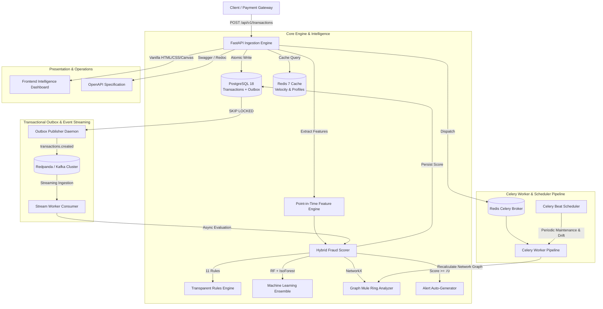
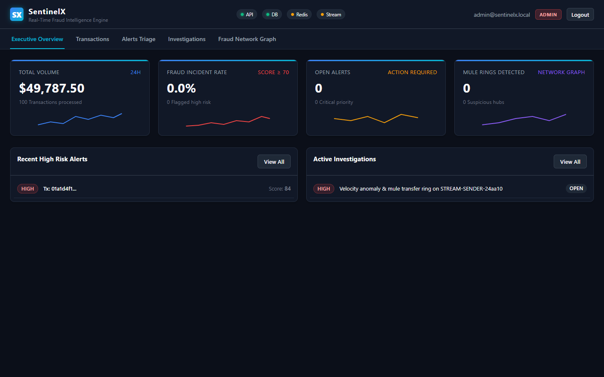
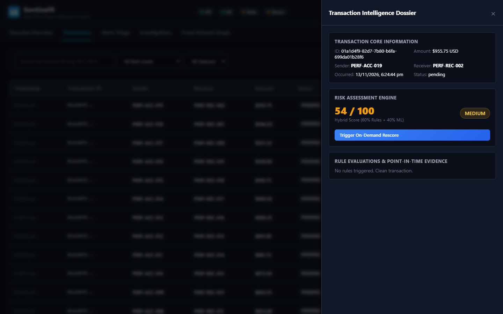
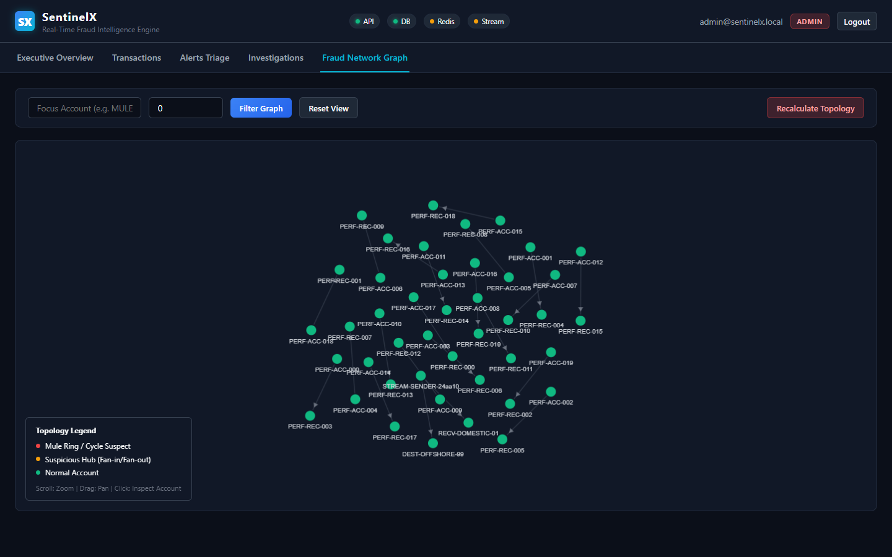
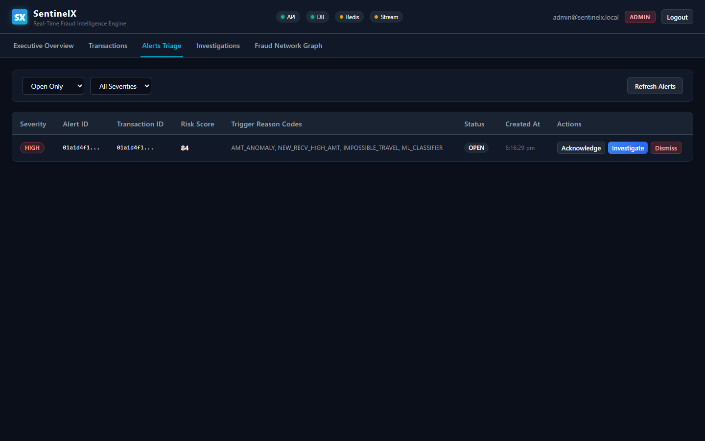
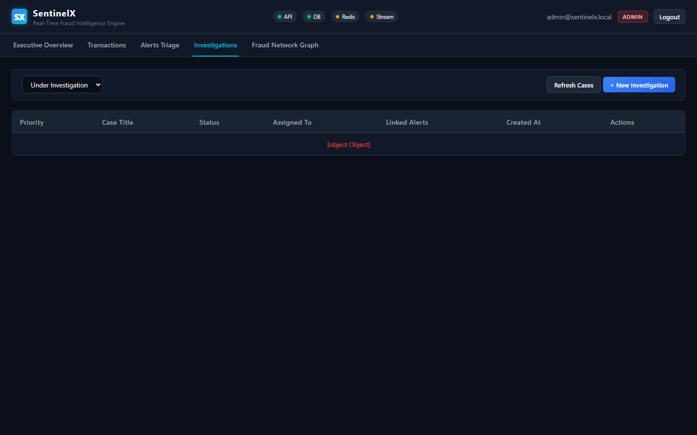
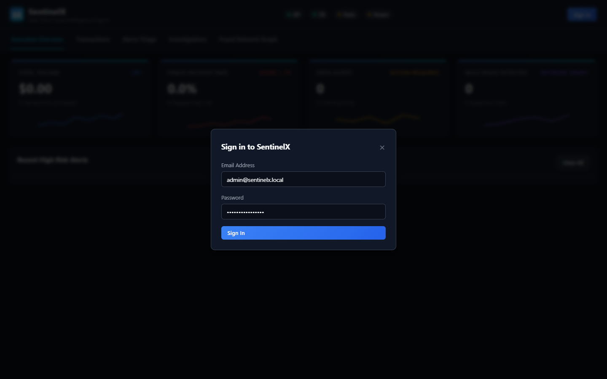

# SentinelX: Real-Time Financial Fraud Detection & Intelligence Platform

[](https://github.com/karthikreddy06/SentinelX/actions)
[](https://github.com/karthikreddy06/SentinelX/releases/tag/v1.0.2)
[](https://www.python.org/downloads/)
[](https://fastapi.tiangolo.com)
[-336791.svg)](https://www.postgresql.org)
[](https://redis.io)
[-FF4B4B.svg)](https://redpanda.com)
[](https://docs.celeryq.dev)
[](https://github.com/astral-sh/ruff)
[](LICENSE)
[](CHANGELOG.md)

SentinelX is an event-driven financial fraud detection and intelligence platform. It combines **deterministic business rules**, **supervised and unsupervised machine learning**, **graph-theoretic money mule ring detection**, and a **transactional outbox pattern** with Redpanda (Kafka API) streaming to provide real-time risk scoring and alert generation.

Includes a zero-dependency **Vanilla HTML5/CSS/Canvas Operations Dashboard** for fraud analysts, investigators, and compliance officers.

---

## Project Status and Known Limitations

Before evaluating or deploying SentinelX, note the following architectural and empirical boundaries:

1. **Synthetic Training Distribution**:
   - The ML ensemble (Random Forest + Isolation Forest) is trained and evaluated **exclusively on synthetic transactions** generated by `ml/synthetic.py` with 1.0% random label flipping.
   - **These metrics do not represent real-world fraud performance** on live banking traffic, where human adversaries actively adapt to decision boundaries.
2. **Hybrid Blending Weights**:
   - The hybrid blend formula ($60\% \text{ Rules} + 40\% \text{ ML}$) is an empirical heuristic that was **not cross-validated** across diverse financial portfolios.
   - On the synthetic held-out test set, the hybrid blend yielded a lower F1 score (`0.4762`) than ML-only (`0.6667`) because deterministic rules suppressed recall on synthetic stealth patterns. Institutions must tune blend weights to their specific risk appetite.
3. **Streaming & Broker Topology**:
   - Event streaming is configured for a single-node Redpanda broker.
   - It does not include an enterprise Schema Registry (e.g. Confluent / Karapace), multi-partition consumer group rebalancing across distributed nodes, or Kafka exactly-once semantics.
4. **Standalone Database Scope**:
   - PostgreSQL 18 with native `uuidv7()` and Redis 7 have been tested on standalone instances.
   - SentinelX has not been benchmarked for multi-region active-active clustering, distributed consensus, or sharded petabyte-scale ledgers.
5. **Host Environment Note (Windows)**:
   - On some Windows machines, host Application Control or endpoint protection policies block compiled Python libraries (`SQLAlchemy`, `pydantic_core`) from loading in `.venv`. Running via **Docker Desktop** is the recommended path.

---

## Architecture Overview

SentinelX operates across four synchronized operational planes: Ingestion, Risk Assessment, Event Streaming, and Investigation Operations.



---

## Key Capabilities

- **Financial Immutability & Idempotency**:
  - Primary keys use PostgreSQL 18 native `uuidv7()` for time-ordered B-Tree clustering.
  - Transactions require an `Idempotency-Key` header with automatic duplicate replay handling and 409 conflict detection.
  - Financial amounts use `NUMERIC(18,2)` with Python `Decimal` precision.
  - Strictly no hard-deletes; status transitions follow a validated state machine.
- **Explainable Hybrid Risk Scoring**:
  - **11 Deterministic Business Rules**: Evaluates velocity bursts, amount anomalies, first-time receivers, unusual hour, impossible travel velocity, new device/IP, structuring, round numbers, pass-through accounts, burst failures, and network mule flags.
  - **Machine Learning Ensemble**: Random Forest ($n=100$) + Unsupervised Isolation Forest trained on synthetic temporal data.
  - **Graceful Fallback**: If models are missing or unreadable, the system automatically falls back to 100% deterministic rules with zero runtime degradation.
  - **Point-in-Time Correctness**: Strictly zero future temporal leakage during feature extraction.
- **Graph Fraud Network & Money Mule Detection**:
  - Constructs a directed transaction graph using `NetworkX`.
  - Automatically identifies cyclic money laundering loops (cycles of length 3 to 6).
  - Flags aggregator fan-in hubs and distributor fan-out hubs with PageRank centrality.
- **Event-Driven Transactional Outbox**:
  - Emits events to `outbox_events` atomically in the same database transaction.
  - Concurrency-safe publisher polls using `SELECT FOR UPDATE SKIP LOCKED` and publishes to Redpanda / Kafka topics (`transactions.created`, `transactions.scored`, `alerts.created`, `transactions.dlq`).
- **Asynchronous Worker Pipeline (Celery 5.7)**:
  - Background asynchronous scoring with exponential retry backoff.
  - Automated Celery Beat scheduled tasks: stale alert auto-escalation (>24h), expired token cleanup, outbox event pruning (>7d), model drift detection, and periodic graph risk recalculation.
- **Vanilla Operations Dashboard**:
  - Handcrafted plain HTML5, CSS3, and modern Vanilla JavaScript in `frontend/`.
  - Zero frontend frameworks, zero build steps, zero external CDN dependencies.
  - Interactive force-directed HTML5 Canvas fraud network graph with live physics, zoom, pan, and node inspection.
  - Slide-over transaction drawer detailing transparent rule trigger breakdown and ML contribution.
  - Full alert triage and investigation case management lifecycle.

---

## Production Intelligence Dashboard

The SentinelX operations dashboard is built exclusively with vanilla HTML5, CSS3, and JavaScript, rendering complex financial intelligence and live topology graphs without external dependencies or build tooling:

| Executive Overview | Transaction Risk Inspection Drawer |
|:---:|:---:|
|  |  |

| Force-Directed Mule Ring Graph | Real-Time Alerts Triage Board |
|:---:|:---:|
|  |  |

| Investigation Dossier & Notes Timeline | Secure Role-Based Authentication |
|:---:|:---:|
|  |  |

---

## Quickstart & Reproduction

### Option A: One-Command Full Stack (Docker Compose - Recommended)
Requires Docker Desktop (Linux containers daemon running):

```bash
# 1. Clone repository
git clone https://github.com/karthikreddy06/SentinelX.git
cd SentinelX

# 2. Build and launch all 8 services in background
docker compose up -d --build

# 3. Run Alembic migrations against PostgreSQL 18
docker compose exec api alembic upgrade head

# 4. Provision initial administrator securely (prompts for password without echoing)
docker compose exec -it api python backend/scripts/create_admin.py --email admin@sentinelx.local

# 5. Seed realistic demonstration transactions with mule rings & structuring
docker compose exec api python backend/scripts/seed_demo.py --num-transactions 250
```

Open your browser to:
- **Operations Dashboard**: [`http://127.0.0.1:8000/`](http://127.0.0.1:8000/)
- **Interactive Swagger Docs**: [`http://127.0.0.1:8000/docs`](http://127.0.0.1:8000/docs)
- **OpenAPI Schema**: [`http://127.0.0.1:8000/openapi.json`](http://127.0.0.1:8000/openapi.json)

### Option B: Local Development (Python 3.11 Host)
> [!NOTE]
> On Windows machines with strict Application Control policies, Python C-extensions in `.venv` may be blocked from execution. Use Option A (Docker) if you encounter library load errors.

```powershell
# 1. Set up environment
Copy-Item .env.example .env
python -m venv .venv
.\.venv\Scripts\Activate.ps1
pip install -r requirements.txt

# 2. Run database migrations
alembic upgrade head

# 3. Create initial admin (prompts interactively for password)
python backend/scripts/create_admin.py --email admin@sentinelx.local

# 4. Start API server
$env:PYTHONPATH="backend"
python -m uvicorn app.main:app --reload --app-dir backend --host 127.0.0.1 --port 8000
```

---

## Machine Learning Evaluation

All models are trained and evaluated on **synthetic data** (`ml/synthetic.py`, seed: 42). Metrics are computed on an identical, held-out test split:
- **Test Set Size**: 298 synthetic transactions (Train: 1,390, Validation: 298, Test: 298)
- **Synthetic Fraud Prevalence**: 5.03% (15 fraud cases, 283 legitimate cases)
- **Label Noise**: 1.0% random label flipping
- **Temporal Leakage Audit**: Verified passed (`max(train_ts) <= min(val_ts) <= min(test_ts)`)

### Side-by-Side Model Comparison (Synthetic Test Set)

| Approach | Precision | Recall | F1 Score | ROC-AUC | PR-AUC | Confusion Matrix (TN / FP / FN / TP) |
|---|---|---|---|---|---|---|
| **Rules-Only Baseline** (10 rules) | `1.0000` | `0.1333` | `0.2353` | `0.7416` | `0.2962` | `283 / 0 / 13 / 2` |
| **Ablation** (ML without `current_amount`) | `0.5417` | `0.8667` | `0.6667` | `0.9651` | `0.8431` | `272 / 11 / 2 / 13` |
| **Hybrid Blend** (60% Rules + 40% ML) | `0.8333` | `0.3333` | `0.4762` | `0.9635` | `0.7715` | `282 / 1 / 10 / 5` |
| **ML-Only (RandomForest)** | `0.5417` | `0.8667` | `0.6667` | `0.9764` | `0.8356` | `272 / 11 / 2 / 13` |

### Key Observations & Caveats
1. **Recall Advantage**: Supervised ML catches 86.67% of synthetic fraud incidents (13 of 15) vs 13.33% (2 of 15) for deterministic rules alone.
2. **Hybrid Blend Caveat**: On this test set, the hybrid blend scores **worse than ML-only** (F1 `0.4762` vs `0.6667`, recall `33.33%` vs `86.67%`). The 60/40 weighting scheme was an empirical heuristic and was not validated or tuned on diverse banking portfolios.
3. **Ablation Interpretation**: The feature ablation model (omitting `current_amount`) matches the same 86.67% recall and 0.9651 ROC-AUC, confirming only that fraud detection does not depend on raw monetary amount alone.
4. For complete methodology and precision-recall trade-offs across operating thresholds, see [docs/MODEL_CARD.md](docs/MODEL_CARD.md).

---

## Performance & Load Benchmarks

Measured using `backend/scripts/docker_load_test.py` against the containerized API on a 12th Gen Intel Core i5-1240P (12 cores / 16 threads, 16 GB RAM, Windows 11 / Docker Desktop 29.6.2):

| Metric | Synchronous Scoring Mode | Async Streaming Ingestion Mode | Delta / Improvement |
|---|---|---|---|
| **Total Requests** | 100 | 100 | - |
| **Concurrency** | 8 worker threads | 8 worker threads | - |
| **Success Rate** | 100% (100/100) | 100% (100/100) | 0 errors |
| **Total Duration** | 9.72 s | 2.41 s | **4.0x faster** |
| **Throughput** | **10.28 req/s** | **41.42 req/s** | **4.0x higher TPS** |
| **Median (p50) Latency** | 768.74 ms | 171.89 ms | **4.5x reduction** |
| **p95 Latency** | 890.47 ms | 308.41 ms | 2.9x reduction |
| **p99 Latency** | 938.84 ms | 342.90 ms | 2.7x reduction |

> [!NOTE]
> **Methodology Notice**: These numbers reflect a single local benchmark run (100 requests, concurrency: 8) on developer hardware. Synchronous scoring measures end-to-end latency (database write, outbox record, 11 rules, and ML inference before responding). Async mode measures ingestion latency only; feature computation, scoring, and alerting execute asynchronously downstream via Redpanda and Celery. See [docs/PERFORMANCE.md](docs/PERFORMANCE.md) for full profiles.

---

## Testing & Quality Assurance

SentinelX enforces a strict quality standard with **102 automated tests** covering unit, integration, and full end-to-end lifecycles:

```bash
# Run full test suite inside Docker against isolated test database
docker compose exec api pytest backend/tests/ -v

# Run code style and lint checks
docker compose exec api ruff check .
```

### Verified Test Suite Summary (PostgreSQL 18 inside Docker)
```
======================= 102 passed, 1 warning in 32.31s ========================
Coverage: 85.69% (target: >=80%)
All checks passed! (0 linter errors)
```

---

## API Reference Overview

All endpoints are versioned under `/api/v1` and protected by role-based access control (`admin`, `investigator`, `analyst`):

| Domain | Method | Endpoint | Description |
|---|---|---|---|
| **Health** | `GET` | `/health` | System health status |
| | `GET` | `/health/database` | PostgreSQL connection probe |
| | `GET` | `/health/redis` | Redis connectivity & cache status |
| | `GET` | `/health/streaming` | Redpanda / Kafka topic status |
| **Auth** | `POST` | `/api/v1/auth/login` | Authenticate and obtain JWT token pair |
| | `POST` | `/api/v1/auth/refresh` | Rotate refresh token with reuse detection |
| | `POST` | `/api/v1/auth/logout` | Revoke tokens to Redis blocklist |
| | `GET` | `/api/v1/auth/me` | Fetch authenticated identity |
| **Transactions** | `POST` | `/api/v1/transactions` | Idempotent transaction creation |
| | `GET` | `/api/v1/transactions` | Filtered, paginated transaction queries |
| | `GET` | `/api/v1/transactions/{id}` | Retrieve transaction by UUID |
| | `PATCH` | `/api/v1/transactions/{id}` | Update status or description |
| | `POST` | `/api/v1/transactions/{id}/cancel` | Cancel pending transaction |
| **Risk Scoring** | `POST` | `/api/v1/transactions/{id}/score` | Trigger synchronous fraud scoring |
| | `GET` | `/api/v1/transactions/{id}/risk` | Inspect transparent risk score & rules |
| **Alerts** | `GET` | `/api/v1/alerts` | Paginated alert triage query |
| | `GET` | `/api/v1/alerts/{id}` | Fetch alert with full event timeline |
| | `PATCH` | `/api/v1/alerts/{id}/status` | State machine transition (`ASSIGNED`, `RESOLVED`) |
| | `GET` | `/api/v1/alerts/stats/summary` | Real-time alert metrics by severity |
| **Investigations**| `POST` | `/api/v1/investigations` | Create new fraud case |
| | `GET` | `/api/v1/investigations/{id}` | Case details with notes and evidence |
| | `POST` | `/api/v1/investigations/{id}/notes` | Add timestamped case note |
| | `POST` | `/api/v1/investigations/{id}/evidence` | Attach verifiable case evidence |
| | `POST` | `/api/v1/investigations/{id}/close` | Conclude case and sync linked alert |
| **Network Graph** | `GET` | `/api/v1/network/accounts/{id}` | Query account graph risk and cycle flags |
| | `GET` | `/api/v1/network/suspicious` | List suspicious mule rings and hubs |
| | `GET` | `/api/v1/network/graph` | Export nodes and links for canvas visualization |
| | `POST` | `/api/v1/network/recalculate` | Re-run graph topology analysis |
| **ML Engine** | `GET` | `/api/v1/ml/model` | Retrieve active model metadata and feature weights |
| | `POST` | `/api/v1/ml/retrain` | Retrain model ensemble on synthetic distribution |

---

## Security Architecture

Detailed security design and OWASP compliance are documented in [Security Review](docs/SECURITY.md):
- **Cryptographic Hashing**: Argon2id via `pwdlib[argon2]`.
- **JWT Protection**: Strict length ($\ge 32$ chars) and insecure placeholder validation on server startup.
- **Defensive Headers**: HSTS, CSP, X-Content-Type-Options, X-Frame-Options.
- **In-Memory Token Storage**: Frontend keeps authentication tokens strictly in JavaScript memory state; no `localStorage` or `sessionStorage` persistence.
- **Audit Logging**: Immutably recorded admin and investigation mutations in `audit_logs`.
- **Input Sanitization**: Pydantic v2 strict typing and database check constraints.

---

## License

This project is licensed under the MIT License — see the [LICENSE](LICENSE) file for details.
Full release history is maintained in [CHANGELOG.md](CHANGELOG.md).
