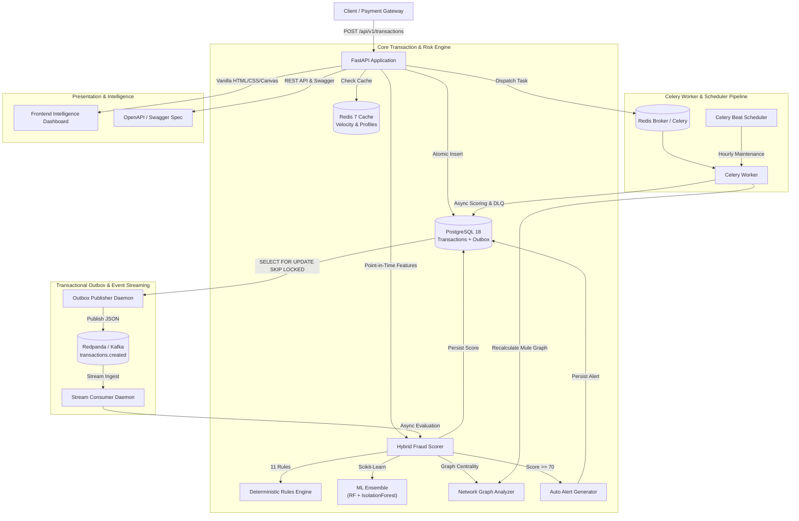
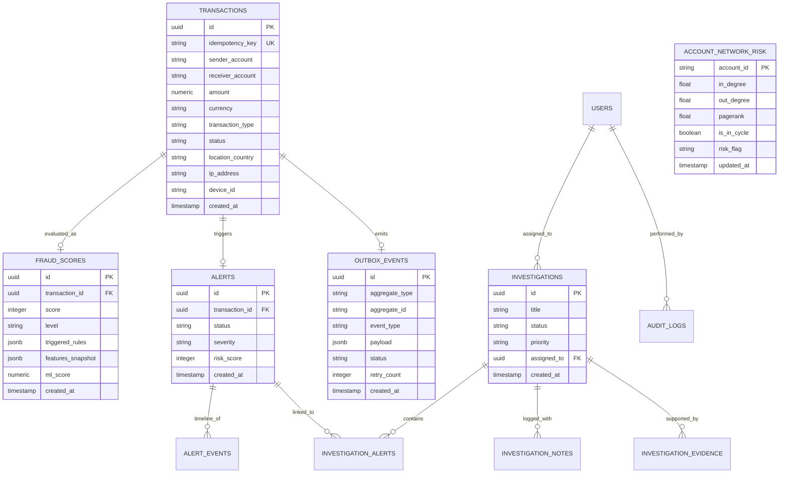

# SentinelX Architecture & System Design

SentinelX is a real-time, event-driven financial fraud detection and intelligence platform designed for high throughput, sub-50ms decisioning, and transparent explainability.

---

## 1. High-Level System Architecture

The following diagram illustrates the end-to-end data flow from transaction ingestion through risk scoring, event streaming, alert generation, and investigation management:



---

## 2. Entity Relationship Diagram (ERD)

SentinelX maintains a strictly normalized, immutable relational schema in PostgreSQL 18 with `uuidv7` time-ordered primary keys and check constraints:



---

## 3. Real-Time Fraud Detection Engine

### 3.1 Point-in-Time Feature Engineering
To guarantee complete reproducibility and eliminate future temporal leakage, feature extraction enforces `Transaction.created_at <= current_transaction.created_at`:
- **Rolling Windows**: 10-minute velocity count, 1-hour transaction volume, 24-hour total spend.
- **Behavioral Ratios**: Deviation from historical sender average amount (`amount / avg_30d`).
- **Geo-Temporal Velocity**: Impossible travel speed calculation ($\Delta \text{distance} / \Delta t > 800\text{ km/h}$).

### 3.2 11 Transparent Business Rules
1. `VELOCITY_BURST`: $\ge 5$ transactions in rolling 10 minutes (+30 points).
2. `AMOUNT_ANOMALY`: Amount exceeds $5\times$ the account's 30-day historical mean (+30 points).
3. `NEW_RECEIVER_HIGH_AMOUNT`: First-time destination account with amount $\ge \$2,500$ (+20 points).
4. `UNUSUAL_HOUR`: Transactions initiated between 02:00 and 05:00 local time (+15 points).
5. `IMPOSSIBLE_TRAVEL`: Geographically distant transactions within an impossible timeframe (+35 points).
6. `NEW_DEVICE_OR_IP`: Unknown device fingerprint and new IP subnet (+15 points).
7. `STRUCTURING`: Multiple transactions just below regulatory reporting thresholds (\$9,000–\$9,999) (+25 points).
8. `ROUND_NUMBER`: Suspicious round number transactions ($\ge \$5,000$ with zero cents) (+10 points).
9. `PASS_THROUGH`: Immediate account drain ($\ge 90\%$ of balance forwarded within 15 minutes) (+25 points).
10. `BURST_FAILURES`: $\ge 3$ consecutive declined attempts prior to success (+20 points).
11. `NETWORK_MULE_RING` / `NETWORK_SUSPICIOUS_HUB`: Topological cycle or hub flags detected by graph engine (+35 / +25 points).

### 3.3 Machine Learning Ensemble
- **Supervised Classifier**: Tuned Random Forest ($n=100$, max depth 8) predicting non-linear fraud interactions.
- **Unsupervised Anomaly Detector**: Isolation Forest ($c=0.03$) capturing zero-day fraud patterns.
- **Hybrid Blending Equation**:
  $$\text{Score}_{\text{composite}} = \min(100, \text{round}(0.60 \times \text{Score}_{\text{ML}} + 0.40 \times \text{Score}_{\text{Rules}}))$$
- **Graceful Fallback**: If models are missing or unreadable, the system automatically falls back to 100% deterministic rules with zero runtime degradation.

---

## 4. Graph Network Analysis & Mule Ring Detection

SentinelX builds a directed transaction graph $G = (V, E)$ using NetworkX:
- **Vertices ($V$)**: Bank accounts and payment endpoints.
- **Edges ($E$)**: Directed transaction flows weighted by transaction volume and count.
- **Cycle Detection**: Simple cycle analysis detecting money laundering loops of length 3 to 6:
  $$A \to B \to C \to A$$
- **Hub Identification**:
  - *Aggregator Hub (Fan-In)*: In-degree to out-degree ratio $\ge 4.0$ with $\ge 5$ distinct in-edges.
  - *Distributor Hub (Fan-Out)*: Out-degree to in-degree ratio $\ge 4.0$ with $\ge 5$ distinct out-edges.
- **PageRank Centrality**: Identifies critical transmission bridges in fraud syndicates.

---

## 5. Event-Driven Architecture & Transactional Outbox

To prevent the classic dual-write distributed transaction hazard between PostgreSQL and Kafka/Redpanda:
1. When a transaction is submitted, the transaction record and an `outbox_events` row are committed **in the exact same database transaction**.
2. A lightweight background daemon queries:
   ```sql
   SELECT * FROM outbox_events 
   WHERE status = 'PENDING' 
   ORDER BY created_at ASC 
   FOR UPDATE SKIP LOCKED 
   LIMIT 50;
   ```
3. Events are published to Redpanda topic `transactions.created`.
4. Upon broker acknowledgment, the outbox record is marked `PUBLISHED`.
5. Failures increment `retry_count`; events exceeding 5 retries are escalated to `transactions.dlq`.

---

## 6. Security & Compliance Architecture

- **Authentication**: JWT with cryptographically secure Argon2id password hashing and SHA-256 refresh token rotation.
- **Access Control (RBAC)**: Role hierarchy (`admin` > `investigator` > `analyst`).
- **Defensive Headers**: HSTS, CSP, X-Content-Type-Options, X-Frame-Options, X-XSS-Protection.
- **Rate Limiting**: Sliding-window counter in Redis with automatic IP/Account lockout after 5 consecutive failures.
- **Audit Trails**: Every administrative and investigation mutation is immutably recorded in `audit_logs`.

